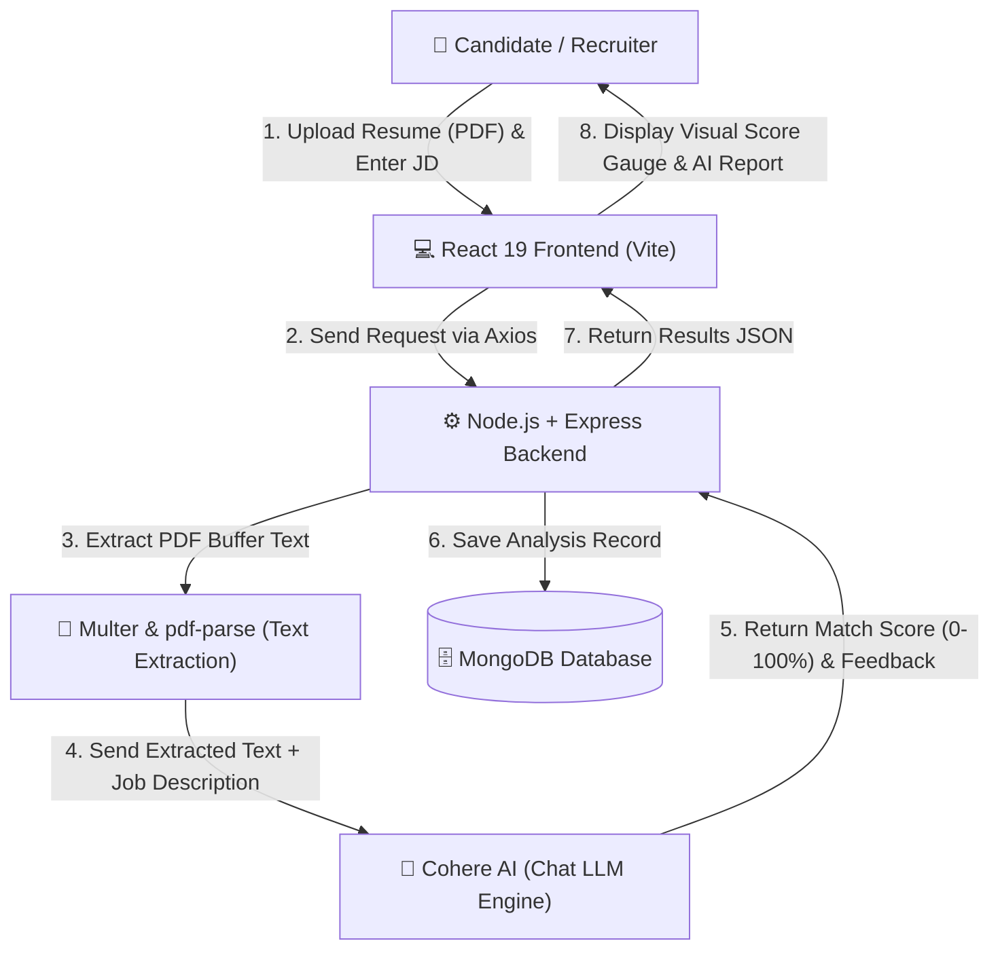
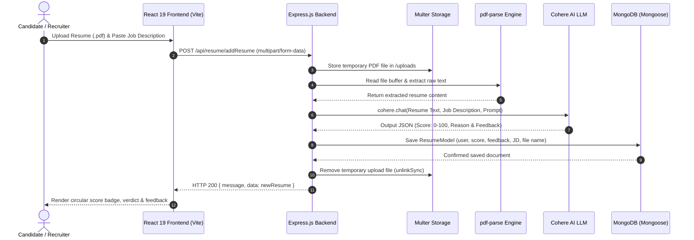

# 🎯 TalentMatch AI — Intelligent Resume Screening & Benchmarking

> An enterprise-grade AI-powered Resume Screening & Candidate Benchmarking application built on the **MERN** stack (MongoDB, Express.js, React 19, Node.js) and powered by **Cohere AI LLMs**.

---

## 📌 Table of Contents
- [Overview](#-overview)
- [Architecture Diagram](#-architecture-diagram)
- [System Data Flow](#-system-data-flow)
- [Tech Stack Details](#-tech-stack-details)
- [Key Features](#-key-features)
- [Project Directory Structure](#-project-directory-structure)
- [Getting Started](#-getting-started)
  - [Prerequisites](#prerequisites)
  - [Environment Variables](#environment-variables)
  - [Installation & Setup](#installation--setup)
- [API Endpoints Reference](#-api-endpoints-reference)
- [Screenshots & UI Showcase](#-screenshots--ui-showcase)

---

## 🚀 Overview

**TalentMatch AI** solves the manual overhead of evaluating candidate resumes against job descriptions. By leveraging **Cohere AI's natural language understanding models**, the system extracts textual credentials from uploaded PDF resumes, performs semantic cross-matching against specified job requirements, computes a multi-dimensional match score (0–100%), and provides constructive feedback outlining candidate strengths and skill gaps.

---

## 🏛 Architecture Diagram (Simple Box Flow)

### 1. Visual Box Flowchart



### 2. ASCII Box Flow Diagram

```text
┌─────────────────────────┐
│  👤 User / Recruiter    │
└────────────┬────────────┘
             │ (1. Upload Resume PDF & Paste Job Description)
             ▼
┌─────────────────────────┐
│  💻 React 19 (Frontend) │  <─── (8. Visual Score Gauge & Feedback Display)
└────────────┬────────────┘
             │ (2. Axios HTTP POST /api/resume/addResume)
             ▼
┌─────────────────────────┐
│  ⚙️ Express.js (Backend)│
└──────┬────────────┬─────┘
       │            │
       │ (3)        │ (6. Store Candidate & Analysis Data)
       ▼            ▼
┌──────────────┐  ┌───────────────────────┐
│ 📄 Multer &  │  │ 🗄️ MongoDB Database  │
│  pdf-parse   │  │  (Mongoose Schemas)   │
└──────┬───────┘  └───────────────────────┘
       │
       │ (4. Resume Text + JD Prompt)
       ▼
┌─────────────────────────┐
│  🤖 Cohere AI (LLM API) │
│  (Calculates Score: 0-100% & Feedback)
└──────┬──────────────────┘
       │
       │ (5. AI Evaluation Response)
       └────────────► Back to Express Backend
```


---

## 🔄 System Data Flow



---

## 🛠 Tech Stack Details

### Frontend (`mern_ai`)
| Technology | Version | Purpose |
| :--- | :--- | :--- |
| **React** | `19.1.0` | Core declarative UI library |
| **Vite** | `7.0.6` | Next-generation frontend build tool and dev server |
| **React Router DOM** | `7.7.1` | Client-side routing with protected view HOCs |
| **Material UI (MUI)** | `7.2.0` | Skeletons, spinners, and elevated UI widgets |
| **MUI Icons** | `7.2.0` | Modern rounded iconography |
| **Axios** | `1.11.0` | Promise-based HTTP client with configured baseURL |
| **Firebase** | `12.1.0` | Google OAuth 2.0 authentication integration |
| **CSS Modules** | Standard | Scoped, zero-runtime CSS design token system |
| **Google Fonts** | N/A | *Plus Jakarta Sans* and *Inter* typography |

### Backend (`backend_ai`)
| Technology | Version | Purpose |
| :--- | :--- | :--- |
| **Node.js** | `>=20.x` | JavaScript runtime with native `.env` file loader |
| **Express.js** | `5.1.0` | Web application framework for routing & middleware |
| **Multer** | `2.0.2` | Disk storage multipart middleware for PDF upload |
| **pdf-parse** | `1.1.1` | Buffer-based text extraction from PDF files |
| **CORS** | `2.8.5` | Cross-Origin Resource Sharing configuration |
| **Nodemon** | `3.1.10` | Auto-restarting development server |

### AI & Database
| Technology | Version | Purpose |
| :--- | :--- | :--- |
| **Cohere AI SDK** | `7.18.1` | Cohere Chat endpoint for candidate benchmarking |
| **MongoDB** | `>=7.x / 8.x` | NoSQL document database |
| **Mongoose** | `8.17.1` | ODM with strict schema definitions and relations |

---

## ✨ Key Features

1. **Intelligent Resume Benchmarking**:
   - Semantic natural language matching using Cohere AI models.
   - Dynamic match percentage (0–100%) and categorised verdict (*Strong Candidate Match*, *Moderate Match*, *Low Relevance*).
   - Detailed feedback highlighting candidate strengths and skill gaps.

2. **Modern Drag & Drop Dropzone**:
   - Clean drag & drop PDF upload zone with type checking and size limit protection.
   - File details badge with one-click replace capability.
   - Built-in **"Load Sample JD"** button for instant one-click testing.

3. **Candidate Screening History**:
   - Complete personal archive of past evaluations.
   - Direct copy-to-clipboard functionality for feedback reports.

4. **Recruiter / Admin Candidate Hub (`/admin`)**:
   - Real-time aggregate metric cards: **Total Screenings**, **Average Match Score**, and **High Matches (≥75%)**.
   - Global view of candidate submissions, contact details, resumes, target roles, and AI assessments.

5. **Dual Authentication Flow**:
   - **Firebase Google Sign-In**: Official Google OAuth login with pop-up window.
   - **Quick Demo Access**: Instant 1-click **Candidate** and **Admin Recruiter** demo profiles for local testing.

---

## 📂 Project Directory Structure

```text
public_ai_resume_mern/
├── backend_ai/                       # Express REST API Server
│   ├── Controllers/
│   │   ├── resume.js                 # PDF parsing, Cohere AI logic & queries
│   │   └── user.js                   # Candidate registration & lookup
│   ├── Models/
│   │   ├── resume.js                 # Resume screening Mongoose schema
│   │   └── user.js                   # User profile Mongoose schema
│   ├── Routes/
│   │   ├── resume.js                 # /api/resume router
│   │   └── user.js                   # /api/user router
│   ├── utils/
│   │   └── multer.js                 # Multer storage configuration
│   ├── uploads/                      # Temporary storage for processing PDFs
│   ├── conn.js                       # MongoDB Mongoose connection
│   ├── index.js                      # Express server entry point (Port 4000)
│   ├── .env.example                  # Environment variable template
│   ├── .env                          # Local environment secrets
│   └── package.json
│
└── mern_ai/                          # Vite + React 19 Frontend
    ├── public/
    ├── src/
    │   ├── assets/                   # Static SVG and image assets
    │   ├── component/
    │   │   ├── Admin/                # Recruiter Candidate Hub (/admin)
    │   │   ├── Dashboard/            # AI Benchmark Screening (/dashboard)
    │   │   ├── History/              # Screening Evaluation History (/history)
    │   │   ├── Login/                # Google & Demo Authentication (/)
    │   │   └── SideBar/              # Sleek Dark Navigation Bar
    │   ├── utils/
    │   │   ├── HOC/
    │   │   │   └── withAuthHOC.jsx   # Route protection higher-order component
    │   │   ├── AuthContext.jsx       # Global authentication state
    │   │   ├── axios.js              # Pre-configured Axios instance (Port 4000)
    │   │   └── firebase.jsx          # Firebase client initialization
    │   ├── App.jsx                   # Main routing structure
    │   ├── App.css                   # Global layout styling
    │   ├── index.css                 # CSS Design Tokens & Reset
    │   └── main.jsx                  # React DOM root entry
    ├── index.html                    # HTML entry with typography links
    ├── vite.config.js                # Vite server & proxy configuration
    └── package.json
```

---

## 🏁 Getting Started

### Prerequisites
- **Node.js**: `v20.x` or higher (tested on `v24.x`)
- **MongoDB**: Local MongoDB community service (`mongodb://localhost:27017`) or [MongoDB Atlas](https://www.mongodb.com/cloud/atlas) cluster URL.
- **Cohere AI API Key**: Obtain a free trial or production API key from [Cohere Dashboard](https://dashboard.cohere.com/api-keys).

---

### Environment Variables

Create a file named `.env` in the `backend_ai/` directory:

```env
PORT=4000
MONGODB_URI=mongodb://localhost:27017/resume_checker
COHERE_API_KEY=your_cohere_api_key_here
```

---

### Installation & Setup

#### 1. Clone the repository
```bash
git clone https://github.com/mashho/public_ai_resume_mern.git
cd public_ai_resume_mern
```

#### 2. Setup and Run the Backend
```bash
cd backend_ai
npm install
npm run start
# Server starts on http://localhost:4000
```

#### 3. Setup and Run the Frontend
In a new terminal window:
```bash
cd mern_ai
npm install
npm run dev
# Frontend starts on http://localhost:5173
```

---

## 📡 API Endpoints Reference

### 👤 User Endpoints (`/api/user`)
| Method | Endpoint | Description | Request Body |
| :--- | :--- | :--- | :--- |
| `POST` | `/api/user` | Register or authenticate user profile | `{ "name": "string", "email": "string", "photoUrl": "string" }` |

### 📄 Resume Endpoints (`/api/resume`)
| Method | Endpoint | Description | Payload Format |
| :--- | :--- | :--- | :--- |
| `POST` | `/api/resume/addResume` | Upload resume, parse PDF, benchmark with Cohere AI | `multipart/form-data`: `resume` (File), `job_desc` (String), `user` (String ID) |
| `GET` | `/api/resume/get/:user` | Retrieve screening history for a specific user | URL Parameter `:user` (User Object ID) |
| `GET` | `/api/resume/get` | Retrieve all screenings across candidates (Admin view) | None |

---

## 📝 License
This project is open-source and available under the [ISC License](LICENSE).
